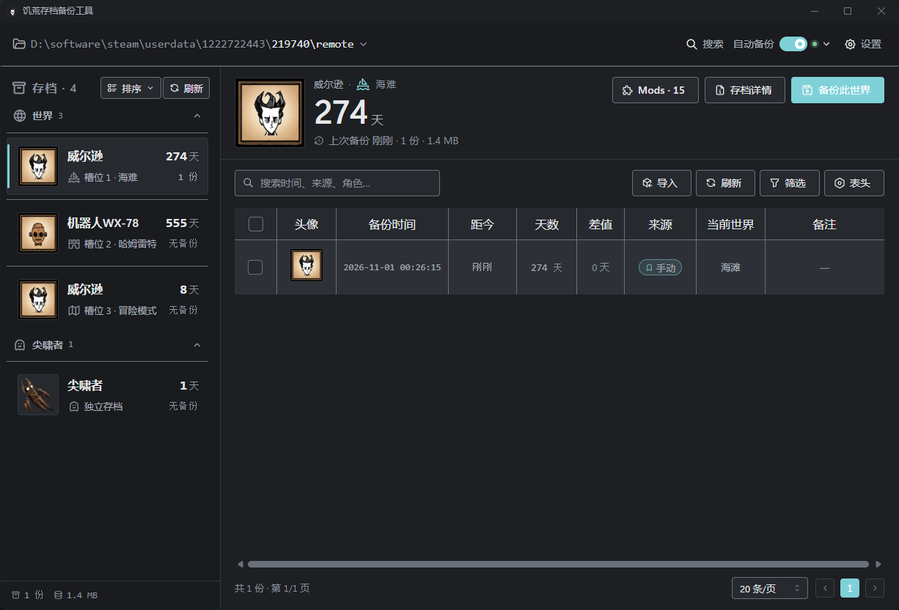

# 饥荒单机版存档备份工具

给《饥荒》**单机版**（Don't Starve）做的存档备份小工具：自动备份、一键恢复、角色头像与 Mod 图标管理。单文件绿色软件，不用安装。



## 普通用户：怎么用

### 第一步：下载

去 [Releases（发行版）](https://github.com/yh51E9/Don-t-Starve-Saver/releases/latest) 页面，下载 `饥荒存档备份工具.exe`。

### 第二步：放好它

1. 新建一个文件夹，随便放哪，比如 `D:\饥荒备份\`
2. 把 `饥荒存档备份工具.exe` 丢进这个文件夹
3. 双击它，完成——就是这么简单

### 第三步：第一次打开

- 它会**自动找到**你的饥荒存档目录（找不到会弹窗让你手动选）
- 左上角显示的就是当前使用的存档目录，点它可以切换

### 之后日常怎么玩

| 你想做什么 | 怎么做 |
|---|---|
| 立刻存一份备份 | 点顶部「备份」按钮 |
| 让它自动备份 | 右上角打开「自动备份」开关（游戏保存/关闭时自动拍快照） |
| 回到某个时间点 | 在备份列表里找到那一行 →「恢复到此」 |
| 恢复错了怎么办 | 恢复前它会自动拍一张「恢复前」备份，随时可以再回去 |
| 给备份写个备注 | 表格里勾出「备注」列，点单元格就能写 |

### 几件要知道的事

- **所有备份、设置、头像**都在 exe 旁边的 `data\` 文件夹里。换电脑？把整个文件夹拷走即可
- **它不会乱动你的游戏存档**——只有你点「恢复」或「删除存档」时才会写存档目录，而且操作前自动拍保护快照
- 只支持**单机版**，不支持联机版（Don't Starve Together）
- 想省空间：设置里可以限制「保留份数 / 保留天数」，旧备份自动清理

## 开发者：从源码运行

前置：**Node 24+**、**Python 3.13+**、[uv](https://docs.astral.sh/uv/)（推荐）

```bash
# 1. 后端依赖（uv 按 uv.lock 精确还原，一条命令）
cd app
uv sync

# 2. 前端依赖
cd ui && npm install

# 3. 开发模式（窗口直连 Vite 热更新）
cd ..
uv run python run.py --dev

# 4. 生产模式（先构建前端）
cd ui && npm run build && cd ..
uv run python run.py
```

**为什么推荐 uv**：依赖版本锁在 `uv.lock` 里，一条命令把 Python 环境还原到和我这边一模一样，不会出现"克隆下来跑不起来"的问题。没有 uv 也可以 `python -m venv .venv` 后 `pip install -e .`，但版本可能飘。

### 测试与门禁

```bash
cd app/backend && uv run python -m pytest -q   # 后端测试
cd app/ui && npm run build                      # 构建（自动跑对比度 + 令牌门禁）
```

### 浏览器调试开关

开发模式下 URL 加参数：`?mock`（示例数据）、`?mock=empty` / `?mock=new`、`?fail=GAME_RUNNING`（注入错误）、`?preset=ledger|nightfall|brass&mode=dark|light`（指定主题截图）、`?view=settings`。

## 打包成 exe

```powershell
cd app
powershell -File packaging\build.ps1
```

一条命令：构建前端 → PyInstaller 打包 → 成品 `饥荒存档备份工具.exe`（约 21 MB 单文件）出现在 `app\` 的**上一级目录**。中间产物自动清理。

## 目录结构

```
Don't Starve Saver\
├─ 饥荒存档备份工具.exe    成品（打包产物，不进 git）
├─ README.md
└─ app\                    全部源码
   ├─ backend\ds_saver\    Python：存档解析 / 备份恢复 / 自动巡检 / 窗口托盘
   ├─ ui\                  React 19 + Mantine 9 + Vite（界面）
   ├─ packaging\           打包脚本与图标
   ├─ docs\                架构说明（ARCH.md）与更新日志（CHANGELOG.md）
   └─ run.py               入口（开发/生产共用）
```

## 常见问题

- **备份会不会很占空间？** 一份存档几 MB，默认全留；想省就在设置里限制份数或天数
- **游戏存档在哪？** 一般在 `文档\Klei\DoNotStarve\`，工具会自动找
- **装了 mod 角色，头像不显示？** 设置 →「重建头像」
- **主题好几种，怎么换？** 设置页点主题卡，点到哪个立刻预览哪个

## 链接

- 作者 B 站：<https://space.bilibili.com/435302929>
- 本仓库：<https://github.com/yh51E9/Don-t-Starve-Saver>
- 更新日志：[app/docs/CHANGELOG.md](app/docs/CHANGELOG.md)
